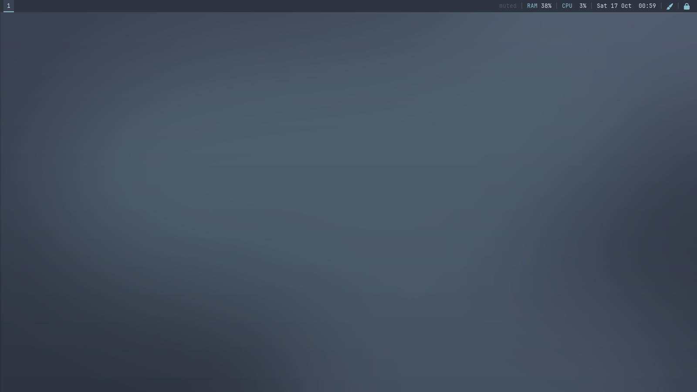
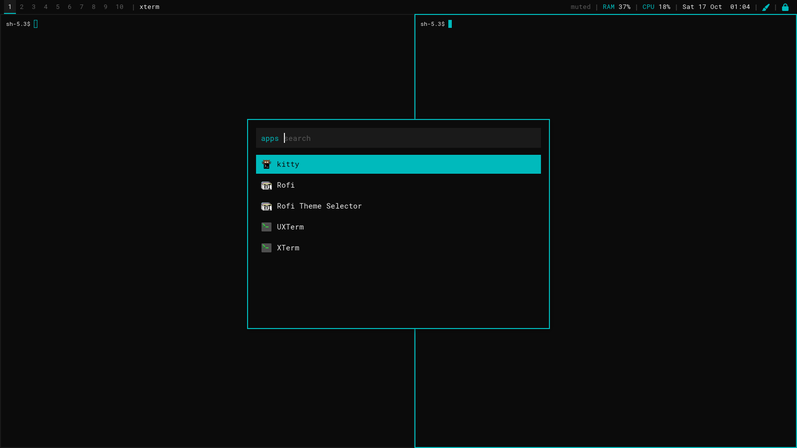
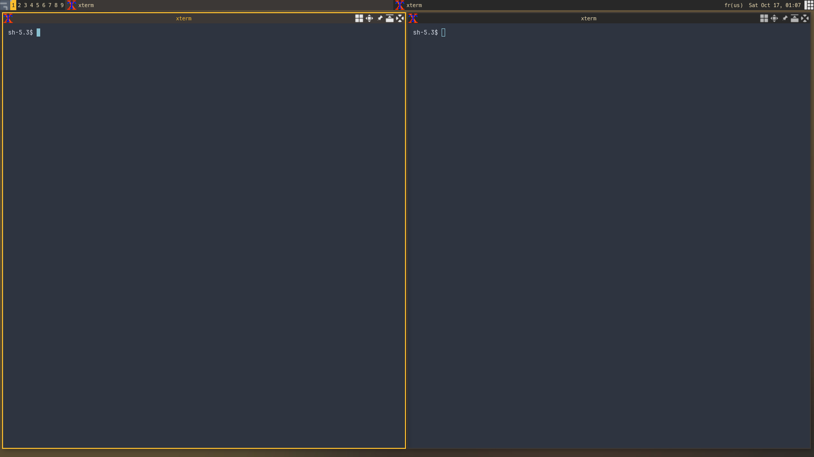

# 42desk

Your own Linux desktop on a 42 school computer: no root, no sudo, nothing changed on the host.

42desk installs [JuNest](https://github.com/fsquillace/junest) (Arch Linux running in user space) and builds a desktop inside it. The desktop starts right after the login screen, in place of GNOME. You choose the window manager, the look, the apps and the 42 tools from menus. 42desk keeps all of it working: NVIDIA graphics, the 42 lock screen, your goinfre, and your home quota.

| Nord on i3 | 42 on bspwm | Gruvbox on awesome |
|:-:|:-:|:-:|
|  |  |  |

## Features

- **A desktop before GNOME:** i3, bspwm, awesome or XFCE. Logging out of it logs you out. If it ever fails to start, GNOME starts as usual, so you're never locked out.
- **Rices:** five ready-made looks (Nord, Gruvbox, Catppuccin, Tokyo Night, 42), or each desktop's stock look. A rice themes the window manager, the bar (polybar), the launcher (rofi), notifications, GTK apps and terminals. Switch live with **Super+Shift+T**.
- **Apps by category:** terminals, browsers, editors, file managers, media, PDF, chat, office and command-line tools. Install sizes are shown before anything is downloaded. You can also pick the default app for links, folders, PDFs and media.
- **42 tools inside:** norminette (pinned to the same version as the school's) and the 42 header for vim and neovim.
- **Host folders:** `/goinfre`, `/sgoinfre`, USB keys, or any folder you choose, available inside JuNest.
- **Profiles:** your whole setup in one file. Reinstall it in one command on another computer, or share it with friends.
- **Maintenance:** `update`, `doctor` (finds and fixes problems) and a clean `uninstall` that puts your own files back.
- **Made for the 42 computers:**
  - **NVIDIA:** the same driver version as the host, so the GPU works inside JuNest.
  - **Locking:** goes through 42's `ft_lock`. Ctrl+Alt+L works, idle locking works, and no other locker is installed.
  - **Caches:** pacman's cache and build files stay in `/tmp/$USER`, never in your home quota.

## Requirements

- A 42 computer (Ubuntu with GNOME), or a similar Linux machine with unprivileged user namespaces enabled.
- `git`, `curl` and `whiptail` (all present on the 42 computers).
- About 4 GB free where the system goes: your home, or `/goinfre` (faster, but tied to that one computer).

## Install

```sh
git clone https://github.com/DavidGailleton/42desk.git ~/42desk
cd ~/42desk
./install.sh
```

The installer asks, in order:

1. **A profile?** Answer the questions yourself, or start from a bundled or saved profile.
2. **Where JuNest lives:** your home (kept when you change computer, uses your quota) or `/goinfre` (this computer only).
3. **Host folders** to make visible inside JuNest.
4. **The desktop:** i3, bspwm, awesome, XFCE, or none (GNOME only, with JuNest still available in the terminal).
5. **The look:** stock, or one of the rices.
6. **The apps,** one category at a time, then the default app for each kind of file.
7. **The 42 apps:** norminette, the 42 header.

Log out and back in: your desktop starts. If anything goes wrong, GNOME starts instead. Run `42desk doctor` to find out why.

To install without any question, use a bundled profile:

```sh
./install.sh --profile minimal-i3 --yes
```

## Usage

After the install, run `42desk` to open the control center, or use the commands directly. In your desktop, the terminals run inside JuNest. Changing the desktop, rice, apps, folders, 42 apps or profile works from there. `install`, `update`, `doctor` and `uninstall` need the host: run them from a GNOME session (or a text console, Ctrl+Alt+F3).

| Command | What it does |
|---|---|
| `42desk` | Control center menu |
| `42desk status` | Shows the current setup |
| `42desk configure desktop\|rice\|apps\|folders\|42apps` | Changes one part of the setup |
| `42desk rice nord` | Switches the look live (`42desk rice --list` lists them; `stock` goes back to the default look) |
| `42desk profile export ~/my.profile` | Saves your setup to a file |
| `42desk profile import ~/my.profile` | Applies a profile to your install |
| `42desk update` | Updates 42desk, the Arch system inside JuNest and the NVIDIA libraries |
| `42desk doctor [--fix]` | Checks everything and repairs what it can |
| `42desk uninstall` | Removes everything 42desk installed |
| `junest` | A shell inside JuNest (`junest -- cmd` runs one command) |

### Keys in the riced desktops

The i3 and bspwm rices use these keys. awesome keeps its own defaults (Super+S lists them), plus the 42 additions.

| Keys | Action |
|---|---|
| Super+Enter | Terminal |
| Super+D | App launcher (rofi) |
| Super+Tab | Window switcher |
| Super+Shift+T | Change the rice |
| Ctrl+Alt+L | Lock (42's `ft_lock`) |
| Super+Q | Close the window |
| Super+H/J/K/L, or the arrows | Move the focus (add Shift to move the window) |
| Super+1…0 | Workspace 1–10 (add Shift to send the window there) |
| Super+F | Fullscreen |
| Super+Shift+R | Restart the window manager in place |
| Super+Shift+E | Log out |

## Profiles

A profile is a small text file listing the desktop, rice, apps, folders and 42 apps:

```ini
# 42desk profile: plain KEY=value lines, read by 42desk (never run).
PROFILE_NAME=Minimal i3: light tiling, Nord look, terminal and browser
DESKTOP=i3
RICE=nord
APPS=alacritty firefox btop
BINDS=/goinfre/@USER@ /sgoinfre/@USER@
FT_APPS=norminette header42
```

- **Sharing:** `@USER@` stands for the login of whoever installs the profile, so you can share yours as is. A missing line keeps that part of the setup as it is.
- **Safety:** 42desk reads profiles field by field and never runs them, so a profile from someone else can't execute anything.
- **Bundled profiles:** `minimal-i3`, `dev-bspwm` and `xfce-beginner` (`42desk profile list`).
- **Saved setup:** your current setup is saved automatically to `~/.config/42-junest/profile` after every change. On a new computer, `./install.sh` offers it as "Your saved setup".

## How it works

- **Where things live:**
  - **JuNest:** an Arch Linux rootfs in `~/.junest` (or wherever you chose), run with bubblewrap in user namespaces. No root is ever needed.
  - **Commands:** `junest`, `junest-session`, `junest-nvidia` and `42desk` go in `~/.local/bin`. Settings are in `~/.config/42-junest/config`.
- **At login:** the display manager sources `~/.xsessionrc`. 42desk adds a small marked block there that starts `junest-session`, before GNOME:
  1. It prepares the NVIDIA libraries if needed.
  2. It starts 42's user services and applies your GNOME keyboard layouts.
  3. It runs the desktop inside JuNest.

  A normal quit logs you out. A failure, or a quit within 10 seconds, lets GNOME start.
- **NVIDIA:** the host's driver version is read from `/sys/module/nvidia/version`. The matching userspace libraries are downloaded once to `/goinfre/$USER/junest-nvidia` and mounted into JuNest. Hybrid laptops keep using Intel by default; `prime-run <app>` runs an app on the NVIDIA GPU.
- **Locking:** lockers running inside JuNest can't check your 42 password. Instead, `ft_lock` inside JuNest asks the host, through a private pipe, to run the real `ft_lock`. 42's idle lock works unchanged.
- **Space:** pacman's cache, build folders and app caches go to `/tmp/$USER` (private, wiped at reboot). The rootfs never keeps downloaded packages.
- **Your files:** rices and the 42 header only replace files after backing them up, and give them back when you go back to stock or uninstall. GNOME's own settings are never touched; the rice settings only apply in your desktop.

## Troubleshooting

- **My desktop doesn't start, I get GNOME.** Run `42desk doctor`: it shows the end of the desktop's log (`/tmp/$USER/desktop.log`). To get GNOME back on purpose, run `touch ~/.config/42-junest/desktop-disabled`, and delete that file to re-enable your desktop.
- **I'm on another computer and nothing works.** If you put JuNest in `/goinfre`, it stays on the first computer. Run `./install.sh` and pick "Your saved setup". Graphics drivers for the new computer are prepared automatically at login.
- **My home is full.** `42desk doctor` shows the usage. The rootfs is usually 2–4 GB; reinstall it in `/goinfre` (`./install.sh`, then choose goinfre), or remove apps with `42desk configure apps`.
- **The screen looks slow or software-rendered.** `42desk doctor --fix` prepares the NVIDIA libraries, which is needed after a driver update on the host.
- **Something else.** `42desk doctor --fix` repairs most broken states: wrappers, the login hook, the pacman lock, the cache location, and rice files.

## Uninstall

```sh
42desk uninstall
```

This removes the rootfs, JuNest, the commands, the login hook and the NVIDIA libraries, and puts back the files a rice or the 42 header replaced. Your desktop config folders and your 42desk settings are only deleted if you tick them. Then delete the repo itself: `rm -rf ~/42desk`.

## Extending it

Each catalog is plain files; adding one adds a menu entry:

- **An app:** add a line `id | arch packages | description` to a category file in `apps/` (official Arch repos only).
- **A rice:** add a folder `rices/<id>/` with a `rice.conf` (palette, font, gaps…), then generate its wallpaper with `python3 tools/gen-wallpapers.py <id>`. The configs come from the shared templates in `rices/_templates/`.
- **A desktop:** add `desktops/<id>.conf` with its packages, start command and default config.
- **A profile:** add a `.profile` file to `profiles/`.

`CLAUDE.md` describes the architecture and the rules the code follows. Check scripts with `shellcheck -x install.sh lib/*.sh bin/* guest/* share/xsessionrc desktops/*.conf rices/*/rice.conf`.

## Credits

- [JuNest](https://github.com/fsquillace/junest) by Filippo Squillace: Arch Linux in user space.
- The rice palettes follow [Nord](https://www.nordtheme.com/), [Gruvbox](https://github.com/morhetz/gruvbox), [Catppuccin](https://catppuccin.com/) and [Tokyo Night](https://github.com/enkia/tokyo-night-vscode-theme). The wallpapers are generated from them, with no third-party images.
- The 42 header comes from [42Paris/42header](https://github.com/42Paris/42header). norminette is installed from PyPI.
